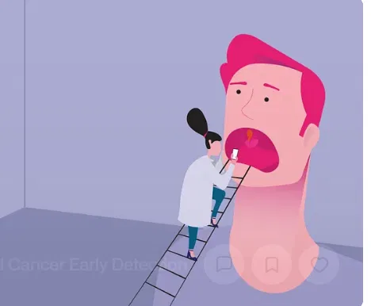

# Oral Cancer Detector — Swin Transformer & Clinical Web Platform

[](https://www.python.org/)
[](https://pytorch.org/)
[](https://huggingface.co/)
[](https://flask.palletsprojects.com/)
[](https://git-lfs.github.com/)

An educational deep-learning project for automated oral cavity image classification into **Cancer** and **Non-Cancer** categories. Powered by a fine-tuned Swin Transformer with transfer learning, paired with a web application for image uploads, real-time inference, and downloadable PDF clinical examination reports.



---

## 🌟 Key Features

- **Fine-Tuned Swin Transformer**: State-of-the-art vision transformer architecture adapted for high-accuracy binary classification (*Cancer* vs. *Non-Cancer*).
- **Interactive Web Interface**: Streamlined UI featuring 3D clinical model visualization, drag-and-drop file upload, real-time confidence readout, and health insights.
- **Automated Clinical PDF Reports**: Instant generation of structured diagnostic assessment summaries powered by ReportLab.
- **Sample Test Suite**: Built-in test images (`dataset_test/`) for immediate local verification without needing external data.
- **Git LFS Integration**: Pretrained model weights (`model.safetensors`) tracked seamlessly with Git Large File Storage.

---

## 🏗️ Repository Structure

```text
oral-cancer-detector/
├── app.py                     # Flask web server and inference API
├── requirements.txt           # Python dependency specifications
├── .gitattributes             # Git LFS configuration for model weights
├── .gitignore                 # Standard Python & environment exclusions
├── README.md                  # Project documentation & setup guide
├── preview.webp               # Application visual preview
├── dataset_test/              # Sample oral images and sample PDF reports
│   ├── 002.jpeg, 005.jpeg...
│   └── oral_image_report.pdf
├── oral_cancer_model/         # Swin Transformer model artifacts
│   ├── config.json            # Model architecture config
│   ├── preprocessor_config.json
│   ├── class_mapping.json     # Class ID to label mappings
│   └── model.safetensors      # Weights (managed via Git LFS)
├── static/                    # Frontend static visual assets
│   ├── monument.png
│   └── monument.webp
└── templates/                 # Jinja2 presentation templates
    └── index.html             # Responsive web user interface
```

---

## 📊 Dataset Reference

- **Source**: [Oral Cancer Dataset on Kaggle](https://www.kaggle.com/datasets/zaidpy/oral-cancer-dataset)
- **Target Classes**:
  1. `Cancer`
  2. `Non-Cancer`
- Preprocessed, resized, and normalized according to Swin Transformer input specifications ($224 \times 224$).

---

## 🚀 Quickstart & Installation

### 1. Prerequisites
- Python 3.10 or higher
- Git & [Git LFS](https://git-lfs.github.com/)

Ensure Git LFS is installed:
```bash
git lfs install
```

### 2. Clone the Repository
```bash
git clone https://github.com/ayse-hatun/oral-cancer-detector.git
cd oral-cancer-detector
git lfs pull
```

### 3. Set Up Virtual Environment

**Windows:**
```bat
python -m venv venv
venv\Scripts\activate
```

**macOS / Linux:**
```bash
python3 -m venv venv
source venv/bin/activate
```

### 4. Install Dependencies
```bash
pip install -r requirements.txt
```

---

## 💻 Running the Application

Start the Flask server:
```bash
python app.py
```

Then visit the local web server in your browser:
```
http://127.0.0.1:5000
```

Upload any image from the `dataset_test/` directory to test the model prediction, view the confidence score, and export a PDF report.

---

## 🔌 API Documentation

### Predict Endpoint

- **Route:** `POST /predict`
- **Payload:** `multipart/form-data` with key `image`

**Example cURL:**
```bash
curl -X POST -F "image=@dataset_test/002.jpeg" http://127.0.0.1:5000/predict
```

**Example Response:**
```json
{
  "prediction": "Cancer",
  "confidence": 98.45,
  "note": "Educational prototype only; not a medical diagnosis."
}
```

### Download Report Endpoint

- **Route:** `POST /download-report`
- **Payload:** `x-www-form-urlencoded` (`prediction`, `confidence`)
- **Returns:** Attachment `oral_image_report.pdf`

---

## ⚠️ Medical Disclaimer

**This software is developed strictly for academic, research, and educational purposes. It is not an FDA-approved or CE-marked medical device and must NOT be used for clinical diagnosis, disease prevention, or treatment decisions.** Always seek the advice of a board-certified physician or dental specialist with any questions regarding medical conditions.

---

## 📄 License

This repository is shared for educational purposes. Please consult the license terms of the underlying Kaggle Oral Cancer Dataset before commercial redistribution.
